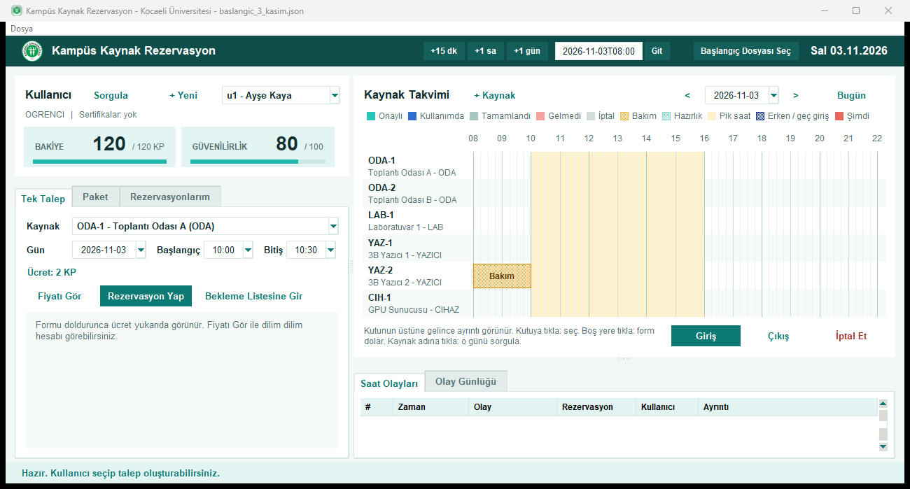
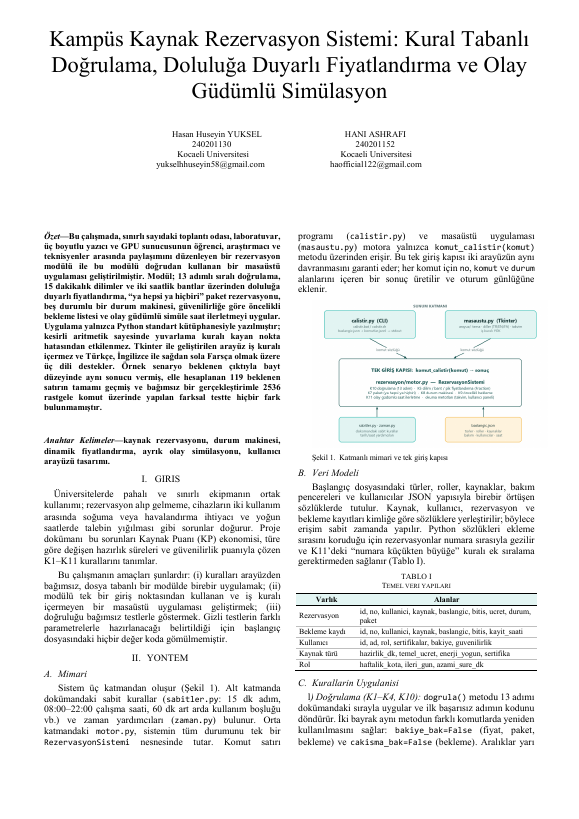
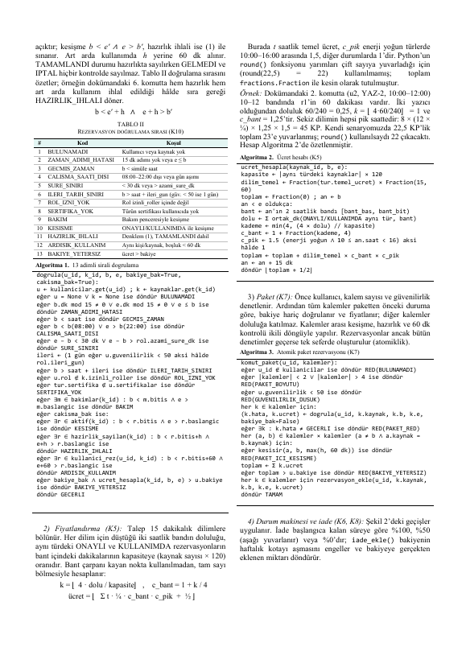
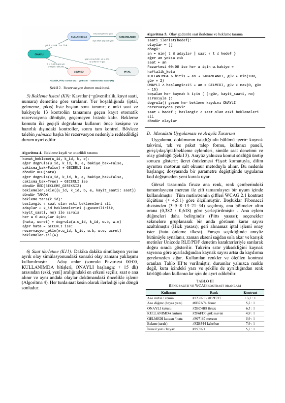
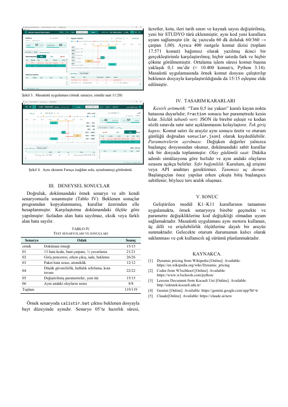

# Campus resource reservation system (Python, Tkinter)

A rule-based reservation engine for shared campus resources (meeting rooms, labs, 3D printers, a GPU server) with a Tkinter desktop app on top of it.

## Context

Coursework for the Software Laboratory I (YazLab I) course, Computer Engineering, Kocaeli University - Fall 2026, project 1. Group project (2 students).

## What it does

- Reads a start file (`baslangic.json`) and a command list (`komutlar.jsonl`) and writes one result line per command
- Checks every request against the rules K1-K11 in a fixed order and returns the first error code
- Occupancy-aware pricing over 15-minute slots and two-hour bands, with peak hours
- All-or-nothing package reservations, waiting lists and a reservation state machine (check-in, check-out, cancel, no-show)
- Event-driven clock simulation; users and resources can be added while it runs (`kullanici_ekle`, `kaynak_ekle`)
- Desktop app: resource calendar with a 15-minute grid, a simulated-time marker and Turkish error texts

## Build / run

Python 3.11 or newer, standard library only, nothing to install.

```
calistir.bat ornek\baslangic.json ornek\komutlar.jsonl > sonuclar.jsonl
./calistir.sh ornek/baslangic.json ornek/komutlar.jsonl > sonuclar.jsonl
python masaustu_uygulamasi.py ornek/baslangic.json
python testler/testleri_calistir.py
```

The 19-command sample in `ornek/` gives exactly `ornek/beklenen.jsonl`; the own test scenarios give 148/148. Code, comments and the interface are in Turkish; the Turkish run notes and folder map are in [BENIOKU.md](BENIOKU.md).

## Screenshot



## Report pages

Full report (Turkish, IEEE format): [docs/report.pdf](docs/report.pdf)






## Notes

No API keys, tokens or credentials are used or stored in this repository.

## License

Free for personal, educational and research use. **Commercial use (selling, publishing the app in a store, or using it in a paid product) is not allowed without written permission.** See `LICENSE` (PolyForm Noncommercial 1.0.0).
